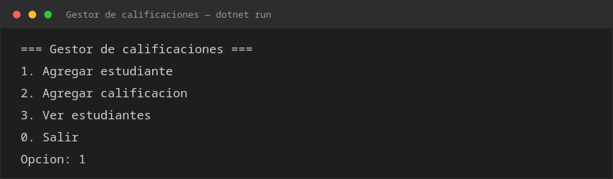
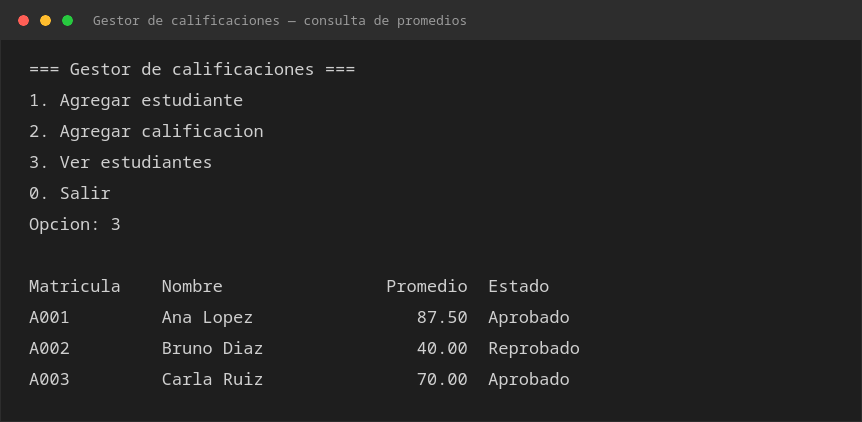

# Gestor de calificaciones

Repositorio: <https://github.com/Anthony-Balbuena/gestor-de-calificaciones>

Aplicación de consola en C# (.NET 10) para registrar estudiantes, cargarles
calificaciones y consultar el promedio y el estado de cada uno.

Clonar el proyecto:

```bash
git clone https://github.com/Anthony-Balbuena/gestor-de-calificaciones.git
```

## Requisitos

- [.NET SDK 10.0](https://dotnet.microsoft.com/download) o superior (`dotnet --version`).
- Opcional: Visual Studio Code con la extensión C# Dev Kit, o Visual Studio 2022+.

Verificar la instalación:

```bash
dotnet --list-sdks
```

## Cómo ejecutar

Desde la carpeta raíz del proyecto (donde está `Gestor de calificaciones.slnx`):

```bash
dotnet run --project "Gestor de calificaciones/Gestor de calificaciones.csproj"
```

O compilar y ejecutar el binario directamente:

```bash
dotnet build
dotnet "Gestor de calificaciones/bin/Debug/net10.0/Gestor de calificaciones.dll"
```

En un IDE: abrir `Gestor de calificaciones.slnx`, seleccionar el proyecto como
proyecto de inicio y presionar **Run** (F5).

## Uso

Al iniciar se muestra el menú principal:

```
=== Gestor de calificaciones ===
1. Agregar estudiante
2. Agregar calificacion
3. Ver estudiantes
0. Salir
```

| Opción | Acción |
| ------ | ------ |
| `1` | Pide matrícula y nombre. La matrícula no puede repetirse ni quedar vacía. |
| `2` | Pide la matrícula de un estudiante existente y una nota entre 0 y 100. |
| `3` | Lista todos los estudiantes con su promedio y estado. |
| `0` | Termina el programa. |

Reglas de negocio:

- Un estudiante sin calificaciones muestra `Sin calificaciones`.
- Promedio **mayor o igual a 70** → `Aprobado`; en caso contrario → `Reprobado`.

Los datos se guardan **en memoria**: al cerrar el programa se pierden.

## Capturas

Menú principal:



Consulta de promedios con estudiantes registrados:



## Estructura del proyecto

```
Gestor de calificaciones/
├── Gestor de calificaciones.slnx        # Solución
├── Directory.Packages.props             # Versiones centralizadas de paquetes
├── README.md
├── capturas/
│   ├── 01-menu-principal.png
│   └── 02-consulta-promedios.png
└── Gestor de calificaciones/
    ├── Gestor de calificaciones.csproj
    ├── Program.cs                       # Punto de entrada y menú de consola
    └── estudiantes.cs                   # Clase Estudiante (modelo y reglas)
```

## Clases

### `Estudiante` — `estudiantes.cs`

Representa a un estudiante y concentra sus datos y sus reglas de cálculo. No
conoce la consola: no lee ni escribe nada, solo responde preguntas sobre sí mismo.

| Miembro | Tipo | Descripción |
| ------- | ---- | ----------- |
| `Matricula` | `string` | Identificador único del estudiante. |
| `Nombre` | `string` | Nombre completo. |
| `Calificaciones` | `List<double>` | Notas cargadas. |
| `Estudiante(matricula, nombre)` | constructor | Inicializa los datos y crea la lista de calificaciones vacía. |
| `AgregarCalificacion(nota)` | método | Agrega una nota a la lista. |
| `CalcularPromedio()` | método | Devuelve el promedio, o `0` si no hay notas. |
| `ObtenerEstado()` | método | Devuelve `Sin calificaciones`, `Aprobado` o `Reprobado`. |

### `Program` — `Program.cs`

Es la interfaz con la persona que usa el programa: contiene el punto de entrada
`Main` y todo el manejo de `Console`.

| Miembro | Descripción |
| ------- | ----------- |
| `Main()` | Punto de entrada. Mantiene la lista de estudiantes y repite el menú hasta que se elige `0`. |
| `AgregarEstudiante(...)` | Lee matrícula y nombre, valida que no estén vacíos ni repetidos y crea el `Estudiante`. |
| `AgregarCalificacion(...)` | Busca al estudiante por matrícula, valida la nota (`0`–`100`) y la agrega. |
| `MostrarEstudiantes(...)` | Imprime la tabla con matrícula, nombre, promedio y estado. |

La separación es intencional: `Estudiante` sabe *qué* es un estudiante y cómo se
calcula su promedio; `Program` sabe *cómo* se le pide y se le muestra al usuario.
Cambiar el menú no afecta al modelo, y el modelo se puede probar sin teclado.
